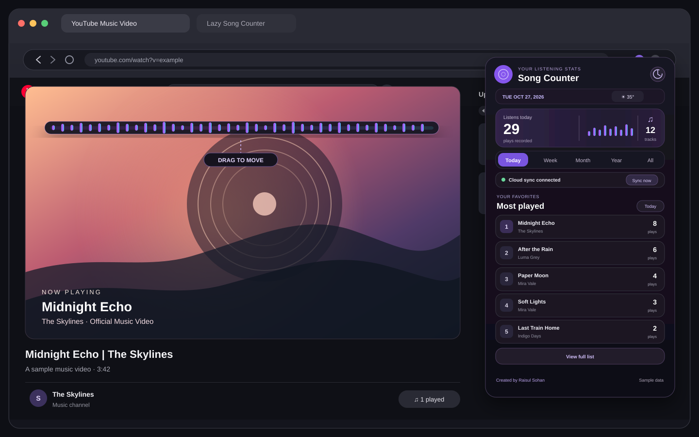

# Lazy Song Counter

A Manifest V3 Chrome extension that tracks listening activity on YouTube and YouTube Music. The popup ranks your most-played tracks for today, this week, this month, this year, or all time.

The compact popup shows the local date, optional city-based weather, a beat-reactive music visualizer, and the top 5 tracks. Click the visualizer to open a draggable frosted-glass visualizer card over the current YouTube page. Click **View full list** to open the searchable, paginated Song Library in a separate tab. The library opens to **Today** by default and can filter history to a specific date. On eligible YouTube watch pages, a local `N played` badge appears beside the Like control.

## Demo



Open the extension popup to see listening totals and your top five songs. Click the mini visualizer to open the draggable visualizer card on the YouTube page; hover over it to show its close button. Use **View full list** to browse the complete history. The image uses sample song data.

## Counting rules

- Videos marked with YouTube's `Music` category are counted. `Entertainment` and `People & Blogs` videos count only when the title and description contain clear music signals, such as song credits, an official music-service link, or a clearly labeled lo-fi/mashup/slowed-reverb mix. Trailers, teasers, reactions, and other non-music formats stay excluded. Videos with no category metadata are skipped.
- Titles that clearly indicate podcasts, reactions, reviews, tutorials, interviews, playlists, or compilations are skipped.
- A full album or jukebox video (`Full Album`, `Audio Jukebox`, `Video Jukebox`) counts as one play of the album, named after the `Album:` credit in the description or the first part of the title, for example `Ekhon Ami (Album)`.
- Plays of the same song are grouped together. Upload labels such as `(Official Video)`, `[Lyrics]`, `| Official Audio` and featured-artist credits are ignored. When the title does not name the artist (`Artist - Song`), the channel name is added, so songs with the same title by different artists stay apart. Words such as `Live` or `Remix` are kept.
- A play counts after 30 seconds. Videos shorter than 60 seconds count after half their duration.
- Pausing and resuming does not create another play. Replaying or looping a song starts a new play session.
- The browser keeps the latest 1,000,000 plays locally, stored by month with a running total per track. A new play writes only its month and one small part of the totals, so recording stays fast as the history grows. The extension requests Chrome's `unlimitedStorage` permission for this history size.

## Local date and weather

The popup shows today's date using the browser's local time zone. Choose a city to show its current weather; the date then follows that city's time zone. The extension does not request device location. Chrome only asks for the optional Open-Meteo city-search permission when **Find** is clicked. Rounded coordinates for the selected city are sent to the Open-Meteo forecast API; only the city name, weather, and time zone are cached locally. The readout links to Open-Meteo for attribution. Its free API tier is for non-commercial use.

The visualizer reads frequency levels from the active YouTube player when the browser allows media capture. It does not route or change playback audio. When YouTube loads a new video or an ad, the visualizer captures the audio again. If a page does not expose an audio signal, it uses a randomized rhythmic animation instead. If a YouTube tab was open before the extension was installed, reloaded, or updated, the popup adds the extension's scripts to it again (Chrome's `scripting` permission), so a page refresh is not needed.

## Google cloud backup

Cloud backup is ready to use. Install the extension, open the popup and click **Connect**, then choose any Google account. Nothing else needs to be set up.

It uses Firebase Authentication, Cloud Firestore, and Chrome's Google sign-in with the Firebase project `lazy-song-counter`; each signed-in Google account gets its own UID-scoped history. The `key` in `extension/manifest.json` gives the extension the same ID, `iaocohnolcopmegaegfnoedobbacflmf`, on every computer, and the Chrome Extension OAuth client is registered for that ID. Firebase Web app values, OAuth client IDs and the manifest key are public identifiers; no service account key, private OAuth secret or private signing key belongs in this extension.

### Run your own Firebase project

These steps are only for a fork that uses its own Firebase project.

1. Create a project in the [Firebase Console](https://console.firebase.google.com/) and register a Web app. Copy its **Web API key** and **Project ID** into `extension/firebase-config.js`.
2. In Firebase Authentication, enable the **Google** provider.
3. Create a **Cloud Firestore** database. Open **Firestore Database → Rules**, replace the rules with the contents of `firestore.rules`, and publish them. Publish them again after every update of this file; version 1.2.0 needs the new rules for the `meta/state` document and the `uploadedAt` field, or sync stops with an "access was denied" message.
4. Load the extension in Chrome using the steps below. Then open `chrome://extensions`, turn on **Developer mode**, and copy the extension ID shown for Lazy Song Counter. To get your own fixed ID, replace the `key` in `extension/manifest.json` with the public key of a key pair you create.
5. In Google Cloud Console, create an OAuth client ID with application type **Chrome Extension** and register that extension ID. Copy the client ID into `extension/manifest.json`, replacing `YOUR_CHROME_EXTENSION_OAUTH_CLIENT_ID.apps.googleusercontent.com`.
6. In Google Cloud Console, open **APIs & Services → Credentials**, edit the Firebase **Web API key**, and set **API restrictions** to *Identity Toolkit API*, *Token Service API* and *Cloud Firestore API*. The key is public, so this limits what it can be used for.
7. Reload the extension in `chrome://extensions`, refresh open YouTube tabs, then click **Connect** in the extension and choose your Google account.

On sign-in, the browser reads the account's history once and merges it with the local plays. After that, each sync reads only the plays uploaded since the last sync, so a sync costs about one Firestore read per new play. New plays upload right after they are recorded; plays recorded offline wait in a queue and upload at the next sync. A sync runs at sign-in, on **Sync now**, when the popup or library opens (at most every ten minutes), when Chrome starts, and when the connection comes back.

**Clear history** removes history from the browser and the connected account, and the account remembers the time of the clear. Other browsers apply the clear at their next sync, and plays from before it are never uploaded again. If the cloud cannot be reached, the browser is cleared at once and the cloud copy at the next sync. A clear while signed out leaves the cloud copy in place; it merges back at the next sign-in. Signing out also leaves the cloud copy in place. The browser keeps the latest 1,000,000 plays; the cloud copy is not trimmed.

`extension/firebase-config.js` contains public Web app identifiers. Do not put a service account JSON file, private key, or OAuth client secret in the extension or this repository.

## Upgrade from 1.1.x

On the first start after the update, the extension converts the old single-list history to the monthly format and regroups the plays with the new track rules. The first sync after the update reads the whole cloud history once, the same as a new sign-in. Publish the new `firestore.rules` before you reload the extension.

## Tests

The rules, the storage and the cloud sync (against a fake Firestore, with two browsers) have unit tests. They need Node.js 20 or later and no packages:

```bash
node --test "tests/*.test.js"
```

## Repository layout

- `extension/` holds everything Chrome loads. Load this folder, not the repository root.
- `tests/` holds the unit tests, `docs/` the README images, and `firestore.rules` the Firestore security rules.

## Load in Chrome

1. Open `chrome://extensions`.
2. Turn on **Developer mode**.
3. Click **Load unpacked** and select the `extension` folder of this repository (or the unzipped release folder).
4. Play a song on YouTube, then open the extension popup to view your stats.
5. After reloading the extension, refresh any YouTube tabs that were already open.
